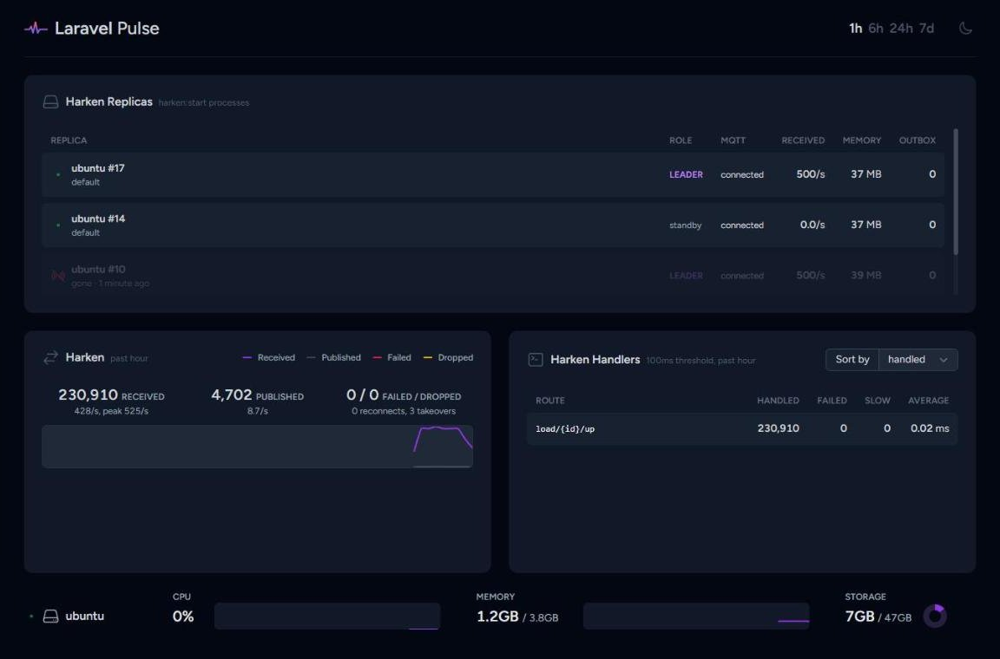
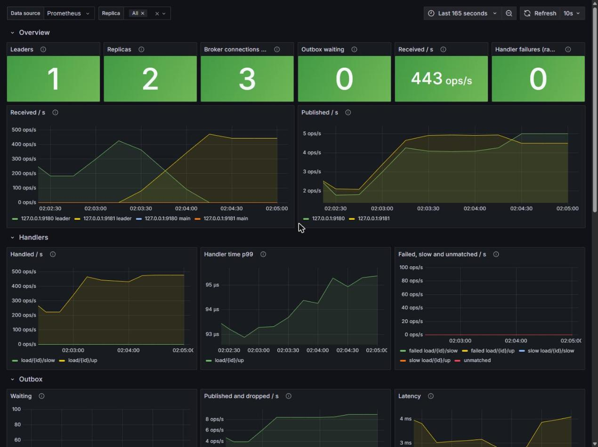

# Harken

Harken is a long-running MQTT client runtime for Laravel. It does for MQTT what Laravel Reverb does for WebSockets: one `php artisan harken:start` process holds the broker connection, routes incoming messages to plain Laravel handlers, and publishes what your application asks it to, from handlers, timers, queued jobs or web requests.

It is a client, not a broker: run it next to EMQX, Mosquitto or any MQTT 3.1.1 / 5.0 broker.

```php
// routes/harken.php
use App\Mqtt\HeartbeatHandler;
use App\Mqtt\StatusHandler;
use Whatef\Harken\Facades\Harken;

Harken::topic('devices/{id}/heartbeat', HeartbeatHandler::class)->qos(1);
Harken::topic('devices/{id}/status', StatusHandler::class)->qos(1)->queued();

Harken::every(5, fn () => app(PendingCommands::class)->sweep());
```

```php
// anywhere in your application, for example a controller
Harken::urgent()->publish("devices/{$id}/command", json_encode(['open' => true]), qos: 1);
```

## Features

- **Routes like Laravel routes.** Topic patterns with `{parameters}`, invokable handlers resolved from the container, raw payload bytes, MQTT 5 properties.
- **Handlers on the event loop or on your queue.** Short handlers run inline; `->queued()` hands a message to a Laravel queue worker so a slow handler never holds up the loop.
- **Publishing from anywhere.** Inside the runtime a publish goes straight out on its connection; from web requests and jobs it is queued in a Redis stream and published by the runtime, at least once, with an urgent lane.
- **Several replicas, each message handled once.** By default one elected leader replica receives the routes (Redis or PostgreSQL lease, fixed client id, persistent session), and a standby takes over in about a second after a deployment or within the lease after a crash. Routes can opt into MQTT shared subscriptions or into every replica.
- **PostgreSQL `LISTEN/NOTIFY` and timers** on the same loop, on the leader by default.
- **MQTT 5 and 3.1.1**, TLS, reconnect with backoff, keepalive, broker limits and reason codes.
- **Operations built in.** Graceful shutdown on SIGTERM, `harken:restart` for deployments, memory and time limits, `harken:status` for health checks, an HTTP `/health` endpoint, Laravel events, Laravel Pulse cards, Prometheus metrics and a Grafana dashboard.
- **Testable.** `Harken::fake()` records publishes and simulates incoming messages; handlers are plain classes.

## Requirements

- PHP 8.4 or 8.5 and Laravel 12 or 13, on Linux x86_64 or aarch64 (both tested in Docker). No PHP extension is required; ext-pcntl (signals), ext-pgsql (NOTIFY without polling) and ext-uv are used when present.
- An MQTT broker. Harken is tested against EMQX 5.8 and with Mosquitto clients.
- Redis for publishing from outside the runtime and for the leader lock (or PostgreSQL 14+ for the lock).

## Installation

```bash
composer require whatef/harken
php artisan vendor:publish --tag=harken-config --tag=harken-routes
```

Point it at your broker in `.env`:

```dotenv
HARKEN_HOST=mqtt.example.internal
HARKEN_PORT=8883
HARKEN_TLS=true
HARKEN_USERNAME=backend
HARKEN_PASSWORD=secret
```

## Usage

### Handlers

```php
namespace App\Mqtt;

use Whatef\Harken\Runtime\Message;

final class HeartbeatHandler
{
    public function __construct(private DeviceRegistry $devices) {}

    public function __invoke(Message $message): void
    {
        // $message->payload holds the exact bytes the device sent
        $this->devices->sawHeartbeat($message->param('id'), $message->payload);
    }
}
```

Inline handlers run on the event loop: keep them short and move database-heavy or slow work to `->queued()`. Handlers that take longer than 100 ms are logged.

### Distribution across replicas

```php
Harken::topic('devices/{id}/up', ReportHandler::class);              // the leader only (default)
Harken::topic('jobs/{id}', JobHandler::class)->shared('workers');     // one replica per message
Harken::topic('config/changed', RefreshCache::class)->broadcast();   // every replica

Harken::listen('outbox_ready', SweepPending::class);                  // PostgreSQL NOTIFY, leader only
Harken::every(60, fn () => Stats::flush())->broadcast();             // a timer on every replica
```

### Publishing

```php
Harken::publish('devices/42/state', $json, qos: 1, retain: true);
Harken::clearRetained('devices/42/state');
Harken::urgent()->publish('devices/42/command', $json, qos: 1);
```

Outside the runtime, `publish()` stores the message in a Redis stream (one `XADD`) and returns at once; every running replica takes part in publishing the stream, and an entry is removed only after the broker acknowledged it.

### Running

```bash
php artisan harken:start
```

Run it like a queue worker: under a process manager, or as a container of your application image.

```yaml
harken:
  image: my-app
  command: php artisan harken:start
  deploy:
    replicas: 2
  stop_grace_period: 15s
  healthcheck:
    test: ["CMD", "php", "artisan", "harken:status"]
```

Run `php artisan harken:restart` on deployment so every runtime stops gracefully and starts again with the new code.

### Testing

```php
Harken::fake();

$this->post('/doors/42/open');

Harken::assertPublished('devices/42/command', fn (string $payload) => json_decode($payload)->open === true);

Harken::simulate('devices/42/heartbeat', '{"battery":81}'); // runs the handler through the real router
```

## Performance

Measured with real `harken:start` processes on a small virtual machine: **2 vCPU, 3.8 GB RAM, Ubuntu 24.04, PHP 8.5** (`StreamSelectLoop`, no ext-uv), with **EMQX 5.8.9, Redis 7.4 and the load generators on the same two cores**. Each device message is a QoS 1 report of about 400 bytes that the handler parses as JSON, checks against an HMAC-SHA256 signature and stores in memory.

| Scenario | Result |
|---|---|
| Inbound, one runtime process, 10,000 msg/s | **0 lost**, broker publish → handler **p50 1.1 ms, p99 3.2 ms**, 27 % of one core, 55 MB RSS |
| Inbound, one runtime process, 15,000 msg/s | **0 lost**, p50 1.6 ms, p99 26.5 ms, 34 % of one core |
| Outbox: queued messages published to the broker | **~17,000 QoS 1 publishes/s**, each acknowledged by the broker before it is removed |
| `Harken::publish()` in a web request | **p50 0.07 ms, p99 0.11 ms** (one Redis `XADD`) |
| A command published while receiving 10,000 msg/s and a handler blocks for 50 ms five times a second | **p99 3.4 ms** with the slow handler `->queued()` (34 ms inline; 50 ms in a synchronous MQTT loop doing the same work) |
| Leader replica stopped by a deployment (SIGTERM) | standby receiving after **0.13 s**, no QoS 1 message lost |
| Leader replica killed (SIGKILL) | standby receiving after **5.1 s** (the 5 s lease), no QoS 1 message lost |
| Broker unreachable for 30 s | reconnects on its own, **no QoS 1 message lost**, a retained message published meanwhile arrives |
| 24 hours at 1,000 msg/s, two replicas, outbox and PostgreSQL NOTIFY traffic | 86.4 million messages, **0 lost**, **memory flat** (leader RSS +0.02 MB from the second hour to the last), 6 % of one core |
| MQTT 5 codec, 400-byte PUBLISH | 474,000 decoded/s, 587,000 encoded/s |

On two cores these numbers are a floor rather than a ceiling: at 20,000 messages per second the broker and the generators used up the machine. Resized to **six cores**, with the runtime on a core of its own:

- A message costs **28 µs** of CPU, handler included, or **20 µs** with the handler bound as a singleton and the JIT on.
- One runtime process received **30,000 QoS 1 messages per second without loss** (p99 3.6 ms, 60 % of its core with the singleton and the JIT). Above that the limit was the broker's delivery to one session (EMQX `max_inflight`), not the process: at QoS 0 the same process took **60,000 per second** without loss, and two replicas sharing the route took **40,000 QoS 1 messages per second**.
- `->queued()` costs the event loop 110 – 170 µs per message (the Redis push), so queue slow work, not every message.

Method, every run and the scripts are in [docs/benchmarks.md](docs/benchmarks.md).

## Monitoring

**Laravel Pulse.** With [Pulse](https://laravel.com/docs/pulse) in your application, set `HARKEN_METRICS_DRIVER=pulse` and add the Harken cards to its dashboard, like Reverb's: replicas and the leader, messages received and published, and every route's handler.

```blade
<livewire:harken.replicas cols="full" />
<livewire:harken.messages cols="6" />
<livewire:harken.handlers cols="6" />
```



**Prometheus and Grafana.** Set `HARKEN_METRICS_DRIVER=prometheus` and every runtime serves `/metrics` and `/health` on port 9180. [docker/monitoring](docker/monitoring) holds a Prometheus and Grafana stack with the Harken dashboard: leader and replicas, traffic, handlers, the outbox, takeovers and broker drops.



## Documentation

- [docs/api.md](docs/api.md): routes, handlers, publishing, NOTIFY, distribution, configuration, events, metrics and operations
- [docs/benchmarks.md](docs/benchmarks.md): end-to-end checks and measurements
- [docs/spikes](docs/spikes/README.md): the experiments behind the design

## License

Harken is open-source software licensed under the [MIT license](LICENSE.md).
